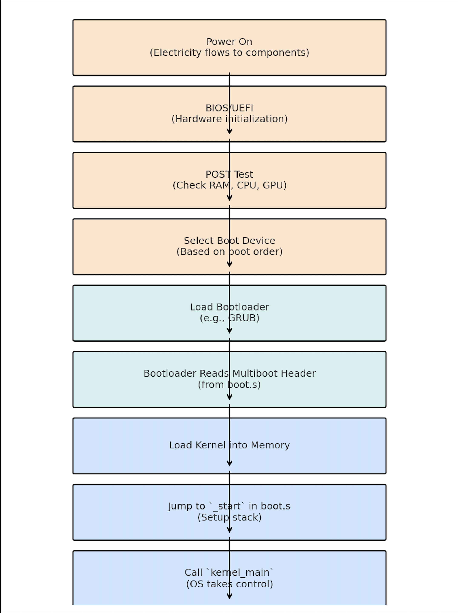

# KFS_2 — GDT & Interrupts, with a debug shell

## Building

The kernel needs an `i686-elf` cross-toolchain plus `nasm`, `grub-mkrescue`
(`grub-pc-bin` + `xorriso`) and `qemu-system-i386`. A ready-to-use VM is
described in the `Vagrantfile`; `install_gcc_cross.sh` builds the cross-GCC.

```sh
make                # build build/kernel.iso
make run            # build + boot it in QEMU
make re             # clean rebuild
# point the build at your toolchain if it is not on PATH:
make CROSS_GCC=~/opt/cross/bin/i686-elf-gcc CROSS_AS=~/opt/cross/bin/i686-elf-as
```

The work stays well under 10 MB.

## Using the kernel

On boot you land on **screen 0** with a status line. Four independent VGA
screens are available:

| Key                | Action                                   |
|--------------------|------------------------------------------|
| `ALT` + `Left/Right` | switch to the previous / next screen   |
| `ALT` + `Up`         | jump to screen 0                       |
| `ALT` + `Down`       | jump to the last screen               |
| `Up` / `Down`        | scroll the current screen's backlog   |
| `ESC`                | **open / close the debug shell**      |

## The debug shell

Press **`ESC`** to toggle the shell. It gives a `Shell $>` prompt with
TAB completion and BACKSPACE editing.

| Command  | Description |
|----------|-------------|
| `help`   | list every command |
| `clear`  | clear the screen |
| `echo`   | echo the arguments |
| `gdt`    | dump the Global Descriptor Table as a colored table |
| `stack`  | hex dump the kernel stack, gdb `x/xw` style, with `esp`/`ebp` highlighted |
| `regs`   | dump the general-purpose, segment and control registers |
| `eflags` | decode `EFLAGS` bit by bit |
| `cpuid`  | CPU vendor string, family/model, feature flags |
| `mem <addr> [words]` | hex + ASCII dump of arbitrary memory (e.g. `mem 0xB8000 16`) |
| `uptime` | seconds since boot from the PIT (IRQ0 @ 100 Hz) |
| `time`   | wall-clock time from the RTC |
| `fault <div0\|bp\|gp\|ud>` | raise a CPU exception to exercise the fault handler |
| `panic`  | trigger a test kernel panic |
| `colors` | print the 16-colour VGA palette |
| `reboot` / `halt` | reset / stop the machine |

### Kernel panics

Fatal faults (`#DE`, `#GP`, `#PF`, `#UD`, …) print a red panic screen with a
full register dump and halt the CPU. Recoverable traps (`#BP` int3, `#DB`)
print a yellow warning and execution resumes — this is the "not all panics
are fatal" distinction asked for by the subject.

---

# Fundamentals:

# GCC Cross-Compiler:

Generally speaking, a cross-compiler is a compiler that runs on platform A (the host), but generates executables for platform B (the target). These two platforms may (but do not need to) differ in CPU, operating system, and/or executable format. In our case, the host platform is your current operating system and the target platform is the operating system you are about to make. It is important to realize that these two platforms are not the same; the operating system you are developing is always going to be different from the operating system you currently use.

## Why cross-compilers are necessary

The compiler must know the correct target platform (CPU, operating system). The compiler that comes with the host system does not know by default that it is compiling something else entirely, unless a lot of problematic options are passed to it, which will create a lot of problems in the future. The solution is to build a cross-compiler.

# bootstrapping:

When a PC boots, it goes through a process called bootstrapping, which involves initializing hardware and loading the operating system. This process starts when the computer is powered on and ends when the operating system is loaded and ready for use.

Here's a more detailed breakdown:

    1. Power-on and Initial Checks:
        When the computer is switched on, the power supply sends electricity to all components. The BIOS (or UEFI) on the motherboard initializes the hardware, including the CPU, memory... 
    2. POST:
        The BIOS/UEFI then runs a Power-On Self-Test (POST). This test checks the basic functionality of the hardware, like the RAM, video card, and other essential components. If an error is detected during POST, the computer may display an error message or halt the boot process.
    3. Boot Device Selection:
        The BIOS/UEFI then identifies the boot device, which is usually the hard drive or SSD where the operating system is stored.
    4. Loading the Operating System:
        The BIOS/UEFI loads the bootloader from the boot device. The bootloader, a small program, then loads the main part of the operating system into the computer's memory (RAM).
    5. System Configuration and User Login:
        Once the operating system is loaded, it performs further system configuration tasks, such as loading drivers for devices and starting necessary services. Finally, the user is presented with a login screen to access their user account.



## Bootloader:

A bootloader is a small program whose primary role is to load the operating system kernel into memory and transfer control to it. It operates in a very minimal environment without multitasking, virtual memory, or drivers.
In OS development, the bootloader serves as the bridge between firmware (BIOS/UEFI) and the kernel.

## GRUB:

GRUB is one of the most popular bootloaders used in Linux and custom OS development. It supports many filesystems and kernels, and is compliant with the Multiboot specification.

## Multiboot:

Multiboot is a specification that defines a standard way for bootloaders (like GRUB) to load operating system kernels.
By conforming to the Multiboot spec, your kernel becomes bootloader-agnostic GRUB and other Multiboot-compliant bootloaders will be able to load it without custom logic.

## Multiboot Header:

To be recognized as a Multiboot kernel, your kernel binary must include a header with:

- A magic number (0x1BADB002)

- A flags field (requesting memory info, alignment, etc.)

- A checksum (ensures integrity)

This header must appear within the first 8 KiB of the kernel file.

# Linker:

A linker script is a configuration file used by the ld linker to control:

- Where in memory your kernel gets loaded

- Where the bootloader should jump to start executing

- How sections like .text, .data, .bss, and the stack are arranged in memory

- Alignment rules for memory sections (e.g., 4K page boundaries)

# GDT:

Global Descriptor Table:

- The GDT defines base access privileges for certain parts of memory.
- We can use an entry in the GDT to generate segment violation exceptions that give the kernel an opportunity to end a process that is doing something it shouldn't.
- The GDT can define if a section in memory is executable or if it is infact, data.
- The GDT itself is a list of 64-bit long entries. These entries define where in memory that the allowed region will start, as well as the limit of this region, and the access privileges associated with this entry.
-  One common rule is that the first entry in your GDT, entry 0, is known as the NULL descriptor. No segment register should be set to 0, otherwise this will cause a General Protection fault, and is a protection feature of the processor. 
- Each GDT entry also defines whether or not the current segment that the processor is running in is for System use (Ring 0) or for Application use (Ring 3).

# IDT:

Interrupt Descriptor Table:

- Is used in order to show the processor what Interrupt Service Routine (ISR) to call to handle either an exception or an 'int' opcode (in assembly).
- IDT entries are also called by Interrupt Requests whenever a device has completed a request and needs to be serviced.

# ISR:

Interrupt Service Routines:

- Used to save the current processor state and set up the appropriate segment registers needed for kernel mode before the kernel's C-level interrupt handler is called. 

## Types of interrupts:

- Hardware interrupts
Triggered by external devices: keyboard press, mouse move, network packet, timer tick.

- Software interrupts
Triggered by programs using special CPU instructions (e.g., int 0x80 in Linux syscalls).

- CPU exceptions
Triggered when the CPU detects an error: divide by zero, invalid instruction, page fault, general protection fault.

# IRQ:

Interrupt Requests:

- IRQs are interrupts that are raised by hardware devices.
- When a device signals an IRQ, remember that an interrupt is generated, and the CPU pauses whatever it's doing to call the ISR to handle the corresponding IRQ.The CPU then performs whatever necessary action (like reading from the keyboard, for example), and then it must tell the PIC that the interrupt came from that the CPU has finished executing the correct routine. 
- CPU tells the right PIC that the interrupt is complete by writing the command byte 0x20 in hex to the command register for that PIC.
- The master PIC's command register exists at I/O port 0x20, while the slave PIC's command register exists at I/O port 0xA0.

## Programmable Interrupt Controllers or PICs:

Each PIC can handle 8 IRQs

- 'Master' IRQ controller
The master IRQ controller is connected directly to the processor itself, to send signals.
The master PIC handles IRQs 0 to 7.

- 'Slave' IRQ controller
The slave is connected to IRQ2 on the master controller. 
The slave PIC handles IRQs 8 to 15.

# KBD:

A keyboard is the most common way for a user to give a computer input

- The keyboard is attached to the computer through a special microcontroller chip on your mainboard.
- This keyboard controller chip has 2 channels: one for the keyboard, and one for the mouse.
- The keyboard controller, being a device accessible by the system, has an address on the I/O bus that we can use for access and control.
- The keyboard controller has 2 main registers: a Data register at 0x60, and a Control register at 0x64.
- Anything that the keyboard wants to send the computer is stored into the Data register.
- The keyboard will raise IRQ1 whenever it has data for us to read.
